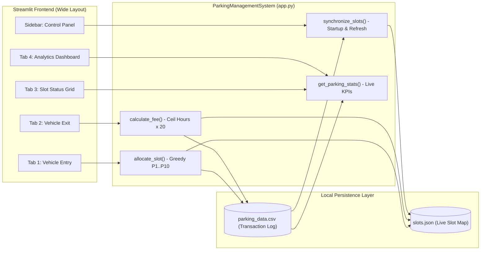
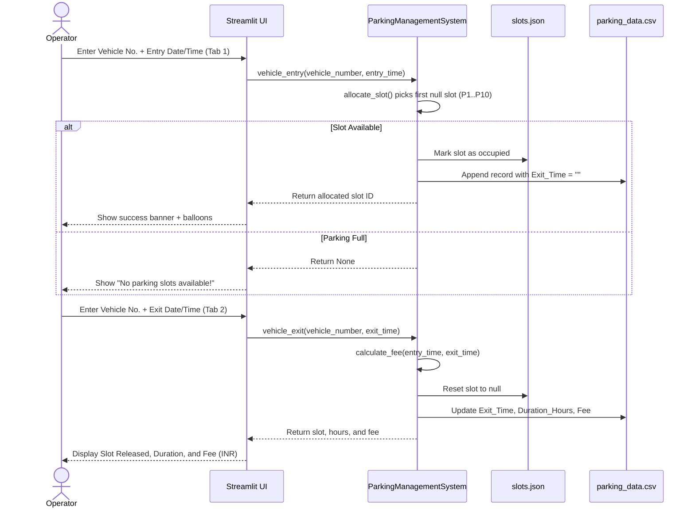
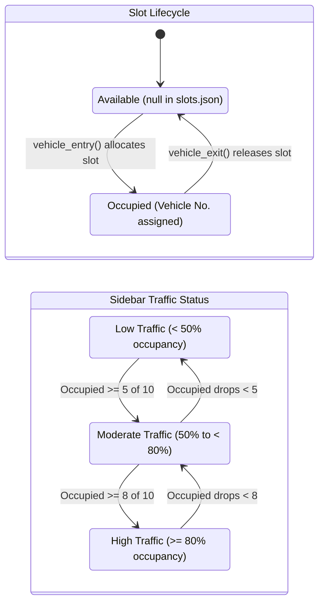
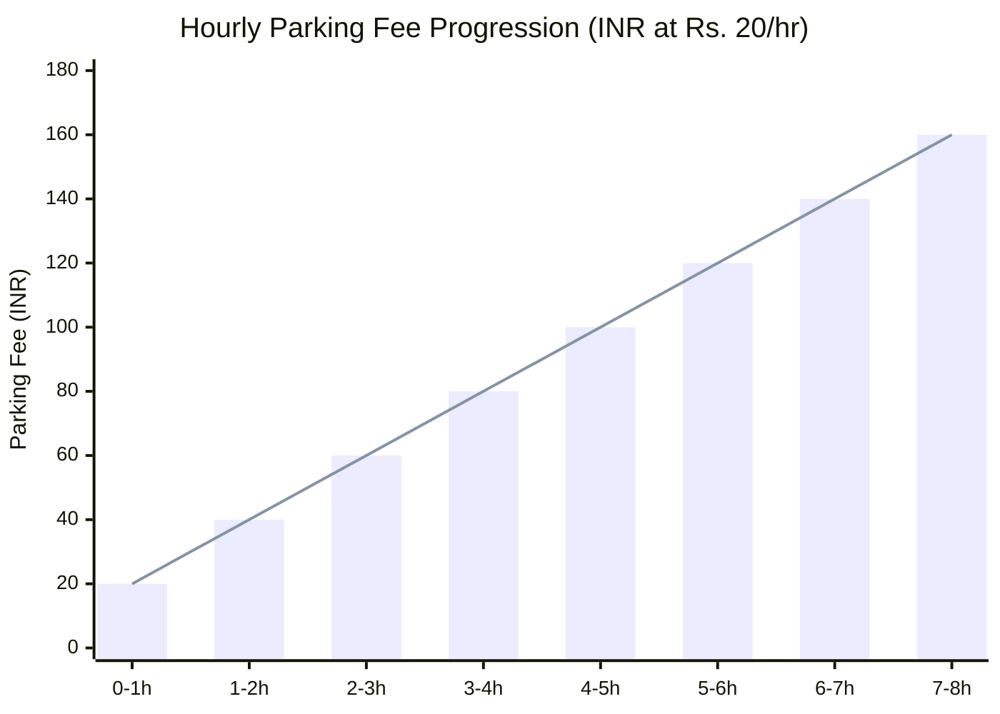
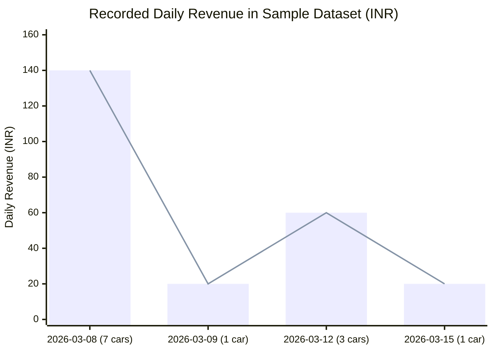

<div align="left">

# ParkHere

[](https://streamlit.io/)
[](https://www.python.org/)
[](https://pandas.pydata.org/)
[](https://plotly.com/)
[](LICENSE)
---
</div>

A Streamlit web application for managing end-to-end parking lot operations.

---

## Overview

**ParkHere** is a Python and Streamlit web application for managing end-to-end parking lot operations. It automatically assigns incoming vehicles to the nearest available slot (`P1`–`P10`), reconciles live slot occupancy with historical logs, computes ceiling-rounded hourly parking charges (`₹20/hour`, minimum `₹20`), and visualizes live utilization and daily revenue through interactive Plotly dashboards.

### Feature Classification

| Domain | Feature | Implementation Behavior | App Location |
| :--- | :--- | :--- | :--- |
| **Slot Allocation** | Greedy First-Available | Scans `P1` → `P10` sequentially and assigns the lowest-index free slot | `app.py` · Tab 1 |
| **Entry & Exit** | Automated Lifecycle | Logs arrival timestamp, tracks active stays, calculates fee on exit, and frees slot | Tab 1 & Tab 2 |
| **Billing Engine** | Hourly Ceiling Pricing | Rounds fractional hours up (`max(1, ceil(hours))`) at `₹20/hr` with `₹20` floor | `calculate_fee()` |
| **Live Monitoring** | 5×2 Visual Slot Grid | Color-coded slot cards (`Available` / ` Occupied`) + live dataframe table | Tab 3 |
| **Analytics** | KPI & Chart Dashboard | 5 KPI cards, Plotly Donut & Duration Histogram, recent stays, daily revenue summary | Tab 4 |
| **Control Panel** | Collapsible Sidebar | Live quick stats, fee rate card, clock, manual refresh, and traffic status badge | Sidebar |
| **Persistence** | Dual-Store Auto-Sync | Reconciles `slots.json` against active rows in `parking_data.csv` on every load | `synchronize_slots()` |

---

## System Architecture

### Component & Data Flow



### Vehicle Entry-to-Exit Sequence



> [!IMPORTANT]
> **Automatic State Reconciliation:** Whenever `ParkingManagementSystem` initializes or the sidebar `🔄 Refresh` button is clicked, `synchronize_slots()` resets all slots in memory and rebuilds `slots.json` directly from active records (rows where `Exit_Time` is empty/`NaN`) in `parking_data.csv`. This prevents stale slot locks if the app restarts mid-session.

---

## Interactive UI & Parking Layouts

### Application Workspace Layout

`ParkHere` configures Streamlit with `layout="wide"` and `initial_sidebar_state="collapsed"`. Navigation is organized into four primary tabs plus a collapsible sidebar control panel:

<table>
  <thead>
    <tr>
      <th width="26%">Sidebar Control Panel (Collapsible)</th>
      <th colspan="4">Main Workspace: <code>SMART PARKING MANAGEMENT SYSTEM</code></th>
    </tr>
    <tr>
      <th>Quick Controls &amp; Status</th>
      <th><code>Vehicle Entry</code></th>
      <th><code>Vehicle Exit</code></th>
      <th><code>Slot Status</code></th>
      <th><code>Analytics Dashboard</code></th>
    </tr>
  </thead>
  <tbody>
    <tr>
      <td>
        • <b>Quick Stats:</b> Available/Total Slots, Today Revenue, Total Revenue<br>
        • <b>System Configuration:</b> Rate (<code>₹20/hour</code>), Live Date &amp; Time<br>
        • <b>Actions:</b> <code>Refresh</code>, <code>Stats</code><br>
        • <b>System Status:</b> Dynamic Traffic Load Badge
      </td>
      <td>
        • Vehicle Number input<br>
        • Entry Date picker<br>
        • Entry Time picker<br>
        • <code>Assign Parking Slot</code> CTA
      </td>
      <td>
        • Vehicle Number input<br>
        • Exit Date picker<br>
        • Exit Time picker<br>
        • <code>Process Exit</code> CTA &amp; receipt cards
      </td>
      <td>
        • 3 Summary Cards (Total, Occupied, Available)<br>
        • 5×2 Interactive Parking Slot Grid (<code>P1</code>–<code>P10</code>)<br>
        • Detailed Slot Table
      </td>
      <td>
        • 5 KPI Gradient Cards<br>
        • Occupancy Donut Chart<br>
        • Duration Histogram<br>
        • Recent History &amp; Day-wise Revenue Tables
      </td>
    </tr>
  </tbody>
</table>

### Parking Lot Grid Layout (`P1`–`P10`)

The **Slot Status** tab renders a 5-column × 2-row visual grid (`st.columns(5)`). Incoming vehicles are assigned greedily in ascending slot order (`P1` → `P10`):

<table>
  <thead>
    <tr>
      <th colspan="5" align="center"> Interactive Parking Lot Layout (Priority Order: P1 → P10)</th>
    </tr>
  </thead>
  <tbody>
    <tr>
      <td align="center"><b>P1</b> (Priority 1)<br>Available / Occupied</td>
      <td align="center"><b>P2</b> (Priority 2)<br>Available / Occupied</td>
      <td align="center"><b>P3</b> (Priority 3)<br>Available / Occupied</td>
      <td align="center"><b>P4</b> (Priority 4)<br>Available / Occupied</td>
      <td align="center"><b>P5</b> (Priority 5)<br>Available / Occupied</td>
    </tr>
    <tr>
      <td align="center"><b>P6</b> (Priority 6)<br>Available / Occupied</td>
      <td align="center"><b>P7</b> (Priority 7)<br>Available / Occupied</td>
      <td align="center"><b>P8</b> (Priority 8)<br>Available / Occupied</td>
      <td align="center"><b>P9</b> (Priority 9)<br>Available / Occupied</td>
      <td align="center"><b>P10</b> (Priority 10)<br>Available / Occupied</td>
    </tr>
  </tbody>
</table>

### Slot & Traffic State Transitions



<details>
<summary><b>Interactive View: Detailed UI Components per Tab &amp; Sidebar</b></summary>

| Section | UI Elements &amp; Widgets | Validation &amp; Feedback Behavior |
| :--- | :--- | :--- |
| **Tab 1: Vehicle Entry** | `st.text_input` (`TN09AB1234`), `st.date_input`, `st.time_input`, primary button | Warns if empty (`⚠️`), balloons + success on allocation (`✅`), error when all 10 slots full (`❌`) |
| **Tab 2: Vehicle Exit** | `st.text_input` (`exit_vehicle`), `st.date_input`, `st.time_input`, primary button | Displays `Slot Released`, `Parking Duration` (`{hours:.1f} hours`), and `Parking Fee` (`₹{fee}`); errors if no active stay |
| **Tab 3: Slot Status** | 3 HTML KPI cards, 5-column slot card grid, `st.dataframe(slots_df)` | Shows `Occupied` (`(Vehicle)`) vs `Available` in real time |
| **Tab 4: Analytics Dashboard** | 5 KPI cards, 2 Plotly charts, Top-10 history table, Day-wise revenue table, 3 summary cards | Formats duration (`In Progress`, `Xh Ym`, `Xh`, `Ym`); shows info alert if no completed stays exist |
| **Sidebar Control Panel** | `st.metric` cards, Fee &amp; Clock HTML cards, `Refresh` &amp; `Stats` buttons, pulsing traffic indicator | `Refresh` reloads JSON/CSV + runs `st.rerun()`; `Stats` prompts user to open Tab 4 |

</details>

---

## Classifications & Business Rules

### 1. Traffic Load Classification

Evaluated dynamically in the sidebar (`app.py`) from `occupancy_rate = (occupied_slots / total_slots) * 100`:

| Classification | Occupancy Threshold | Active Slots (10-Slot Lot) | Indicator Color | Hex Code |
| :--- | :--- | :--- | :--- | :--- |
| **Low Traffic** | `occupancy_rate < 50%` | `0 – 4` vehicles | Bright Green | `#00ff00` |
| **Moderate Traffic** | `50% <= occupancy_rate < 80%` | `5 – 7` vehicles | Amber / Orange | `#ffaa00` |
| **High Traffic** | `occupancy_rate >= 80%` | `8 – 10` vehicles | Blue | `#3498db` |

### 2. Fee Structure & Duration Tiers

Parking charges are calculated in `ParkingManagementSystem.calculate_fee()` with a fixed rate of **₹20/hour** (`fee_per_hour = 20`) and a minimum charge of **₹20** (`min_fee = 20`):

```python
hours = (exit_time - entry_time).total_seconds() / 3600
billable_hours = max(1, int(hours) + (1 if hours % 1 > 0 else 0))
fee = max(self.min_fee, billable_hours * self.fee_per_hour)
```

| Duration Bracket (`hours`) | Rounding Logic | Billable Hours | Total Fee (₹) | Classification |
| :--- | :--- | :---: | :---: | :--- |
| `0.00h – 1.00h` | Clamped to minimum 1 hour | `1` | **₹20** | Minimum Flat Charge |
| `1.01h – 2.00h` | Ceiling to next whole hour | `2` | **₹40** | Standard Hourly Tier |
| `2.01h – 3.00h` | Ceiling to next whole hour | `3` | **₹60** | Standard Hourly Tier |
| `3.01h – 4.00h` | Ceiling to next whole hour | `4` | **₹80** | Standard Hourly Tier |
| `4.01h – 5.00h` | Ceiling to next whole hour | `5` | **₹100** | Extended Stay |
| `5.01h – 6.00h` | Ceiling to next whole hour | `6` | **₹120** | Extended Stay |
| `6.01h – 7.00h` | Ceiling to next whole hour | `7` | **₹140** | Extended Stay |
| `7.01h – 8.00h` | Ceiling to next whole hour | `8` | **₹160** | Full-Day Stay |

#### Fee Progression Chart (`0–8 Hours`)



<details>
<summary><b>Interactive View: Worked Fee Calculation Examples</b></summary>

| Scenario | Entry Timestamp | Exit Timestamp | Raw Duration | Billable Hours | Calculated Fee |
| :--- | :--- | :--- | :---: | :---: | :---: |
| **Quick Drop-off** *(from `parking_data.csv`)* | `2026-03-08 14:07:54` | `2026-03-08 14:09:19` | `0.02h` (1m 25s) | `1` (min floor) | **₹20** |
| **Exact 2 Hours** | `2026-03-08 10:00:00` | `2026-03-08 12:00:00` | `2.00h` | `2` | **₹40** |
| **2 Hours 30 Minutes** | `2026-03-08 10:00:00` | `2026-03-08 12:30:00` | `2.50h` | `3` (ceiling) | **₹60** |

</details>

---

## Visual Analytics & Sample Insights

### Dashboard Charts & KPI Classification

| Analytics Component | Library / Type | Data Source &amp; Grouping | Purpose |
| :--- | :--- | :--- | :--- |
| **Key Performance Cards (×5)** | Custom HTML Cards | `get_parking_stats()` + `len(parking_data)` | Occupancy %, Vehicles Today, Today's Revenue, Total Vehicles, Total Revenue |
| **Parking Occupancy Distribution** | Plotly `go.Pie` (`hole=0.4`) | `occupied_slots` (`#FF6B6B`) vs `available_slots` (`#4ECDC4`) | Instant available-capacity ratio |
| **Parking Duration Distribution** | Plotly `px.histogram` (`nbins=10`) | Completed stays (`Exit_Time != ""`) | Frequency distribution of stay lengths (`#45B7D1`) |
| **Recent Parking History** | `st.dataframe` (Last 10 rows) | Reversed tail of `parking_data` with `format_duration()` | Tracks active (`In Progress`) and completed exits |
| **Day-wise Revenue Analysis** | `st.dataframe` (Grouped) | `groupby('Entry_Date')` aggregating count &amp; fee sum | Daily throughput and revenue comparison |
| **Summary Statistics Cards (×3)** | Custom HTML Cards | Aggregated across active dates | Total Days, Avg Vehicles/Day, Avg Revenue/Day |

### Sample Historical Revenue Chart (`parking_data.csv`)

The repository includes 12 recorded test transactions across 4 active dates (`₹240` total revenue, `3.0` average vehicles/day, `₹60` average revenue/day):



<details>
<summary><b>Interactive View: Sample Dataset Daily Breakdown (<code>parking_data.csv</code>)</b></summary>

| Date | Vehicles Parked | Slots Utilized | Daily Revenue (₹) | Avg Duration (Hours) |
| :--- | :---: | :--- | :---: | :---: |
| `2026-03-08` | `7` | `P1`, `P2` | **₹140** | `0.03h` |
| `2026-03-09` | `1` | `P1` | **₹20** | `0.01h` |
| `2026-03-12` | `3` | `P1`, `P2` | **₹60** | `0.03h` |
| `2026-03-15` | `1` | `P1` | **₹20** | `0.01h` |
| **Total / Average** | **`12` total (`3.0`/day)** | **`P1`–`P2` active** | **₹240 total (`₹60`/day)** | **`0.03h`** |

</details>

---

## Technology Stack & Project Structure

### Technology Classification

| Layer | Technology | Version Spec | Role in Project |
| :--- | :--- | :--- | :--- |
| **Language** | Python | `3.8+` *(Dev Container: `3.11`)* | Core business logic (`ParkingManagementSystem`) |
| **Web Framework** | Streamlit | `>= 1.28.0` | Multi-tab UI, sidebar controls, state management, HTML/CSS styling |
| **Data Processing** | Pandas | `>= 2.0.0` | CSV I/O, active-vehicle filtering, date grouping, duration stats |
| **Visualization** | Plotly | `>= 5.15.0` | Interactive Donut occupancy chart (`go.Pie`) &amp; histogram (`px.histogram`) |
| **Storage** | JSON &amp; CSV | Built-in (`json`, `csv`) | Lightweight file-based state (`slots.json`) and history (`parking_data.csv`) |
| **Environment** | Dev Container | `python:1-3.11-bookworm` | Pre-configured VS Code / Codespaces container on port `8501` |

### Repository Structure

```text
Smart-Parking-Management-System/
├── .devcontainer/
│   └── devcontainer.json   # Codespaces / VS Code Dev Container config (Python 3.11, port 8501)
├── app.py                  # Core ParkingManagementSystem class + Streamlit UI
├── parking_data.csv        # Persistent vehicle entry/exit & fee audit log
├── slots.json              # Real-time P1-P10 slot occupancy map
├── requirements.txt        # Python dependencies (streamlit, pandas, plotly)
├── LICENSE                 # MIT License (Copyright 2026 PERAM MADHAN MOHAN REDDY)
└── README.md               # Structured documentation, tables, layouts & charts
```

| File | Classification | Read / Write Access | Purpose |
| :--- | :--- | :--- | :--- |
| [`app.py`](app.py) | Application Entrypoint | Read-only at runtime | Defines `ParkingManagementSystem` and renders the Streamlit interface |
| [`requirements.txt`](requirements.txt) | Dependency Manifest | Read during setup | Pins minimum versions for `streamlit`, `pandas`, and `plotly` |
| [`slots.json`](slots.json) | Operational State | Read &amp; Write | Maps `P1`–`P10` to `null` or the parked vehicle plate string |
| [`parking_data.csv`](parking_data.csv) | Historical Ledger | Read &amp; Append/Update | Stores all active and completed parking transactions |
| [`.devcontainer/devcontainer.json`](.devcontainer/devcontainer.json) | Container Spec | Read by IDE/Codespaces | Installs dependencies and launches Streamlit automatically |
| [`LICENSE`](LICENSE) | Legal | Static | MIT License text |

---

## Installation & Setup

### Setup Methods Overview

| Method | Best For | Prerequisites | Launch Port |
| :--- | :--- | :--- | :---: |
| **Local Python Environment** | Windows / macOS / Linux local development | Python `3.8+`, `pip` | `8501` |
| **Dev Container / Codespaces** | Zero-setup cloud or containerized runs | Docker / GitHub Codespaces | `8501` (auto-forwarded) |

### Local Setup Steps

1. **Clone the repository and enter the directory**

   ```bash
   git clone https://github.com/madhanmohanreddyperam06/Smart-Parking-Management-System.git
   cd Smart-Parking-Management-System
   ```

2. **Create a virtual environment and install dependencies**

   ```bash
   python -m venv .venv
   # Windows (PowerShell): .\.venv\Scripts\Activate.ps1
   # macOS/Linux:          source .venv/bin/activate
   pip install -r requirements.txt
   ```

3. **Run the Streamlit application**

   ```bash
   streamlit run app.py
   ```

   Open `http://localhost:8501` in your browser if it does not launch automatically.

<details>
<summary><b>Interactive View: Dev Container / GitHub Codespaces Auto-Setup</b></summary>

Opening this repository in GitHub Codespaces or VS Code Dev Containers uses [`.devcontainer/devcontainer.json`](.devcontainer/devcontainer.json) to automatically:

1. Provision `mcr.microsoft.com/devcontainers/python:1-3.11-bookworm` with Python &amp; Pylance extensions.
2. Install packages via `pip3 install --user -r requirements.txt` (`updateContentCommand`).
3. Forward port `8501` and launch the app via:

   ```bash
   streamlit run app.py --server.enableCORS false --server.enableXsrfProtection false
   ```

</details>

---

## Data Storage & Schemas

### `slots.json` Schema

Stores a key-value JSON object mapping each of the 10 parking slots (`P1`–`P10`) to its live occupancy state:

| Key Pattern | Value Type | Allowed Values | Meaning |
| :--- | :--- | :--- | :--- |
| `"P1"` … `"P10"` | `string \| null` | `null` | Slot is **Available** and eligible for allocation |
| `"P1"` … `"P10"` | `string \| null` | `"<VEHICLE_NO>"` *(e.g., `"TN09AB1234"`)* | Slot is **Occupied** by the specified vehicle |

### `parking_data.csv` Schema

| Column Name | Data Type | Format / Example | Populated When | Notes |
| :--- | :--- | :--- | :--- | :--- |
| `Vehicle` | `string` | `AP04BZ0264` | Vehicle Entry | Entered by operator |
| `Slot` | `string` | `P1` | Vehicle Entry | Assigned automatically by `allocate_slot()` |
| `Entry_Time` | `datetime (str)` | `2026-03-08 14:07:54` | Vehicle Entry | Formatted as `%Y-%m-%d %H:%M:%S` |
| `Exit_Time` | `datetime (str)` | `2026-03-08 14:09:19` | Vehicle Exit | Empty string `""` while vehicle is parked |
| `Duration_Hours` | `float` | `0.02` | Vehicle Exit | `0` while active; rounded to 2 decimal places on exit |
| `Fee` | `int / float` | `20` | Vehicle Exit | `0` while active; computed in ₹ on exit |
| `Entry_Date` | `date (str)` | `2026-03-08` | Analytics Tab | Derived from `Entry_Time` during day-wise aggregation |

<details>
<summary><b>Interactive View: Sample Data Previews (<code>slots.json</code> &amp; <code>parking_data.csv</code>)</b></summary>

**`slots.json`** (all slots available):

```json
{
    "P1": null,
    "P2": null,
    "P3": null,
    "P4": null,
    "P5": null,
    "P6": null,
    "P7": null,
    "P8": null,
    "P9": null,
    "P10": null
}
```

**`parking_data.csv`** (excerpt):

```csv
Vehicle,Slot,Entry_Time,Exit_Time,Duration_Hours,Fee,Entry_Date
AP04BZ0264,P1,2026-03-08 14:07:54,2026-03-08 14:09:19,0.02,20,2026-03-08
AP04MM8900,P2,2026-03-08 14:22:43,2026-03-08 14:23:05,0.01,20,2026-03-08
AP09BN6789,P1,2026-03-12 10:40:09,2026-03-12 10:43:43,0.06,20,2026-03-12
AP09NV2345,P1,2026-03-15 20:08:39,2026-03-15 20:09:30,0.01,20,2026-03-15
```

</details>

---

## API Reference & Troubleshooting

<details>
<summary><b>Interactive View: <code>ParkingManagementSystem</code> Method Classification (<code>app.py</code>)</b></summary>

| Category | Method | Inputs | Output / Return | Side Effects |
| :--- | :--- | :--- | :--- | :--- |
| **Initialization** | `load_data()` | `—` | `None` | Loads `slots.json` &amp; `parking_data.csv` with fallback defaults; runs `synchronize_slots()` |
| **State Sync** | `synchronize_slots()` | `—` | `None` | Resets slots and maps active CSV rows (`Exit_Time` empty/NaN) back to `slots.json` |
| **Persistence** | `save_slot_data()` | `—` | `None` | Writes formatted JSON to `slots.json` |
| **Persistence** | `save_data()` | `—` | `None` | Calls `save_slot_data()` and exports DataFrame to `parking_data.csv` |
| **Slot Query** | `get_available_slots()` | `—` | `list[str]` | Read-only list of unoccupied slot keys |
| **Slot Ops** | `allocate_slot(vehicle_number)` | `vehicle_number: str` | `str \| None` | Assigns first available slot in `self.slots` |
| **Slot Ops** | `free_slot(slot)` | `slot: str` | `None` | Resets specified slot in `self.slots` to `None` |
| **Billing** | `calculate_fee(entry_time, exit_time)` | `datetime`, `datetime` | `(timedelta, float, int)` | Computes duration, decimal hours, and ceiling fee (min `₹20`) |
| **Transactions** | `vehicle_entry(vehicle_number, entry_time)` | `str`, `datetime` | `str \| None` | Allocates slot, appends CSV row, saves both files |
| **Transactions** | `vehicle_exit(vehicle_number, exit_time)` | `str`, `datetime` | `dict \| None` | Updates active row with exit time/duration/fee, frees slot, saves files |
| **Analytics** | `get_parking_stats()` | `—` | `dict` | Returns slot counts, occupancy %, today's vehicles &amp; revenue, total revenue |
| **Analytics** | `get_duration_stats()` | `—` | `Series \| DataFrame` | Returns Pandas `.describe()` statistics for completed stays |

</details>

### Troubleshooting Classification

| Issue Category | Symptom | Likely Cause | Resolution |
| :--- | :--- | :--- | :--- |
| **Port Conflict** | Streamlit fails to bind to `8501` | Another process is already using port `8501` | Run `streamlit run app.py --server.port 8502` |
| **Missing Packages** | `ModuleNotFoundError` on launch | Virtual environment inactive or packages missing | Activate `.venv` and run `pip install -r requirements.txt` |
| **Stale Slot Status** | UI shows wrong slot state after manual file edit | In-memory `st.session_state` needs reload | Click `Refresh` in the Sidebar Control Panel |
| **File Write Error** | `PermissionError` on entry/exit | Read-only permissions on `slots.json` or `parking_data.csv` | Grant write permissions or close spreadsheet apps locking CSV |

### Planned Enhancements

| Priority | Feature Area | Planned Capability |
| :---: | :--- | :--- |
| `P1` | **Pricing &amp; Vehicle Tiers** | Differentiated tariffs for Two-Wheelers, Sedans, SUVs, and EVs |
| `P2` | **Access &amp; Zones** | Multi-lot support and Employee vs. Visitor pass differentiation |
| `P3` | **Automation &amp; Alerts** | License plate recognition (ANPR) and SMS/Email entry-exit alerts |
| `P4` | **Payments** | Integrated digital payment gateway (UPI / QR receipt generation) |

---

## License & Contact

Distributed under the **MIT License**. See [`LICENSE`](LICENSE) for full terms (`Copyright (c) 2026 PERAM MADHAN MOHAN REDDY`).

| Maintainer | Channel | Contact Details |
| :--- | :--- | :--- |
| **Madhan Mohan Reddy** | **Email** | [madhanmohanreddyperam06@gmail.com](mailto:madhanmohanreddyperam06@gmail.com) |
| **Madhan Mohan Reddy** | **Mobile** | `+91 9110395993` |

